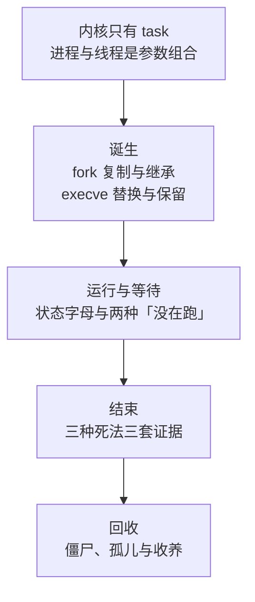
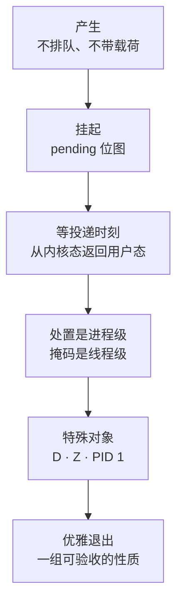
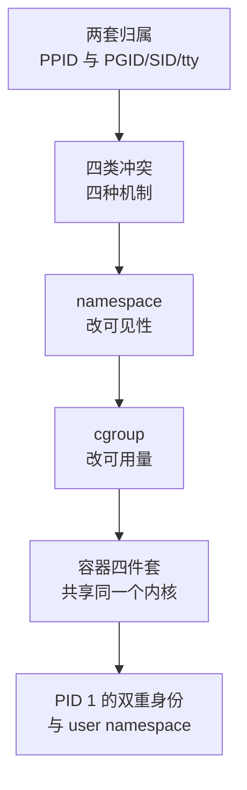
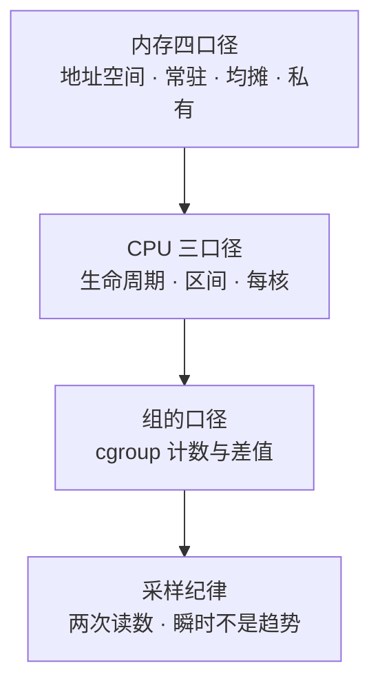

---
tags:
  - Linux
  - 进程
  - 信号
  - 串讲
created: 2026-10-14
---

# 串讲：五条主线

本章正文按建造顺序排列：先机制，再体系，再动手、判断与治理。值班与复盘里的提问不按这个顺序进入——它从一个现象或一个「为什么」开始，回答者需要一条能立刻走下去的路径，并在对方追问时知道拐向哪里。

本篇把全章收成五条主线。它与知识地图的关系是：地图里的一条时间主线在这里拆成两条（一个进程的一生、信号的生命周期），三条跨阶段的核对对象（占用口径、限制层级、归属关系）各自独立成一条。每条主线以一组高频提问为入口，给出沿线的节点顺序；每个节点写四件事：**先答**（第一句先给出的结论）、**举证**（这句话落到哪个字段、文件或命令上）、**深入**（对方再追一层时补上的边界与代价）、**衔接**（问题跨出本节点时拐向哪里）。节点只给骨架：字段的完整读法（是什么、单位、判据、与谁同看、转向哪一步）集中在《一个进程的一生》第 5.4 节与各实操场景；被剖析到第 0 层的错误答法在《高频误判》；想验收自己的回答停在哪一层，用《盲区排查》。

## 1. 主线怎么选

| 被问到什么 | 走哪条主线 | 从哪个节点进入 |
| --- | --- | --- |
| 「进程和线程有什么区别」「`fork` 的原理与开销」 | 主线一 | 从节点 1 或节点 2 进入 |
| 「`exec` 之后什么还在」「为什么重启后还占着旧端口」 | 主线一 | 从节点 3 进入 |
| 「进程有哪些状态」「`D` 状态是什么」「没在跑是为什么」 | 主线一 | 从节点 4 进入；追问「杀不掉」时拐主线二节点 4 |
| 「僵尸进程怎么办」「137 说明什么」「服务消失了怎么查」 | 主线一 | 从节点 5 或节点 6 进入 |
| 「`kill` 的原理」「`kill -9` 为什么杀不掉」「信号会不会丢」「处理函数跑在哪个线程」 | 主线二 | 从节点 2 进入；按追问分流到位图（节点 3）或特殊对象（节点 4） |
| 「怎么优雅停机」「`SIGHUP` 是不是重载」 | 主线二 | 从节点 6 进入 |
| 「`fork` 报资源暂时不可用」「容器里起不了进程」 | 主线三 | 从节点 5 进入 |
| 「`ulimit` 或 `limits.conf` 改了不生效」 | 主线三 | 从节点 3 进入，落到节点 4 的验收依据 |
| 「too many open files」「怎么给服务配上限」 | 主线三 | 从节点 6 进入；配上限的完整走法从节点 1 开始 |
| 「一条 `kill` 能打到谁」「进程组与会话是什么」 | 主线四 | 从节点 1 进入 |
| 「容器和虚拟机有什么区别」「namespace 和 cgroup 各管什么」 | 主线四 | 从节点 2 或节点 5 进入 |
| 「容器里 `free` 为什么不准」「容器 `stop` 为什么超时」「rootless 安全吗」 | 主线四 | 从节点 4、5、6 进入 |
| 「这个进程占了多少内存」「RSS 加总为什么对不上」 | 主线五 | 从节点 1 进入 |
| 「CPU 打满但整机不高」「三种工具的 CPU 数字为什么不一样」「事件计数怎么看」 | 主线五 | 从节点 2 或节点 3 进入 |

## 2. 主线一：一个进程的一生

这条线按时间顺序走：从「内核里只有 task」讲到退出状态被领走。被通知这一阶段独立成主线二，因为它本身就构成一条完整的提问链；两条线在「`D` 状态为什么杀不掉」这一处相接。

**入口提问**：「进程和线程有什么区别」「`fork` 做了什么、开销和内存大小是什么关系」「`execve` 之后什么东西还在」「进程有哪些状态、`D` 状态意味着什么」「僵尸进程怎么产生的、怎么处理」「退出码 137 说明什么」「服务半夜消失了怎么查」。

### 2.1 内核只有 task

- **先答**：内核没有「进程」与「线程」两种实体，只有一种调度实体 task；用户态说的「进程」是共享同一个地址空间的一组 task（共用一个线程组 ID，即 TGID），「线程」是这组里的单个 task。创建时的一组 `clone` 标志位逐项决定这次共享什么，因此两者的区别是参数组合，不是两种东西。
- **举证**：`getpid()` 与 `ps` 的 `PID` 列都是 TGID；单个线程要 `ps -eLf` 或 `/proc/<pid>/task/<tid>/` 才看得见。共享与独立的完整清单（地址空间、fd 表、信号处置共享；寄存器、栈、信号掩码独立）在《进程与线程》第 3 节。
- **深入**：这个设计换来内核简单、用户态灵活，代价有三——内存计数会重复（`VmRSS` 是整组共享的一个数）、一个线程崩溃默认带走整组（`SIGSEGV` 是进程级事件）、线程数本身是开销（每个 task 一份 `task_struct` 与内核栈，x86_64 上通常 16 KiB）。
- **衔接**：追问「`ps` 行数能不能算剩余额度」时拐主线三节点 5——被限制与被杀的都是 task，而行数是线程组口径。

### 2.2 创建为什么拆两步，`fork` 复制了什么

- **先答**：`fork` 加 `execve` 拆成两步，换来的不是效率而是中间窗口——新程序还没跑、进程已经独立，重定向、`setuid`、`setrlimit`、进入 namespace 都在这个窗口里完成；同时 `execve` 失败可以回退。`fork` 本身复制内核控制结构与页表，继承资源限制、信号处置与掩码、fd 表、工作目录与进程组会话；不复制物理内存内容——父子的页表项都标为只读并指向同一批物理页，谁写谁复制（写时复制）。
- **举证**：单次 `fork` 的成本与映射的页数成正比，与常驻集不是线性关系；真正的峰值由「`fork` 之后写多少」决定，数据库 `BGSAVE` 这类「`fork` 后大量写」的形态，内存规划看的是写入量而不是进程原大小。
- **深入**：`fork` 失败要在第一时间分清两个错误码——`EAGAIN` 撞的是任务数上限，`ENOMEM` 是内核结构、页表或承诺额度不足，两者的修法完全不同；展开在主线三节点 5。承诺额度与超额承诺的完整口径属于内存章，这里只划界。
- **衔接**：「内存大的服务不能 `fork`」这类说法为什么不成立，答到这里已经够了；现代路径（`posix_spawn` 走 `clone3`）的边界在《进程的诞生：fork 与 exec》第 1、4 节。

### 2.3 `execve` 保留什么，两个高频故障形态

- **先答**：`execve` 换掉地址空间——代码、堆、栈、映射全部替换，PID 不变；保留的是未标 `FD_CLOEXEC` 的 fd、文件偏移、工作目录、`umask`、资源限制、信号掩码、进程组与会话；被重置的是信号处置（恢复默认动作，被显式忽略的仍保持忽略）。
- **举证**：保留与替换的完整对照表在《进程的诞生：fork 与 exec》第 3 节。
- **深入**：值班里反复出现的两个形态都长在「保留」上——`exec` 之后仍屏蔽着某个信号（新程序在无人处理的情况下继续屏蔽 `SIGTERM`，表现为「这个服务对信号没反应」）；`exec` 之后仍占着旧句柄（旧连接、旧日志文件一直被持有，`df` 与 `du` 对不上、端口仍被占用）。「PID 没变但版本变了」不是幻觉，那是程序自己 `exec` 自己的热重启。
- **衔接**：「对 `SIGTERM` 没反应怎么查」拐主线二节点 3 的位图排查。

### 2.4 运行与等待：状态字母是归类，不是原因

- **先答**：`R`/`S`/`D`/`T`/`Z` 来自内核同一张状态表，只说明「在哪一类」，永远不说明「在等谁」；`D` 是内核态不可中断等待，它既可能是本地块设备，也可能是网络存储、内核锁或驱动，背后的处置方向完全不同。
- **举证**：判断原因读三样——`/proc/<pid>/status` 的 `State`、`/proc/<pid>/wchan`（当前睡在哪个内核函数上，进程在跑时是 `0`）、`/proc/<pid>/stack`（内核态调用栈，需要权限与内核栈回溯支持）。
- **深入**：「没在跑」有两种——等事件与排队等 CPU。区分用同一个进程的自愿与非自愿上下文切换的**增长速度**（`pidstat -w`）：非自愿那侧涨得快说明在等 CPU，自愿那侧涨得快说明在等事件；两者都高只说明既在抢又没抢到，不能单独定性。
- **衔接**：「`D` 状态为什么杀不掉」拐主线二节点 4；「是不是 CPU 瓶颈」拐主线五节点 2 先定口径。

### 2.5 三种死法与 137 的定性

- **先答**：死法分三种，各留一套证据——正常退出（退出码与应用日志）、被信号杀死（`128+N`，服务管理器的退出状态字段）、被 OOM 选中（同样死于 `SIGKILL`）。137 是 `128+9`，它只回答「怎么死的」，不回答「谁干的」。
- **举证**：能让进程收到 `SIGKILL` 的至少有四种来源——内核 OOM（整机或组级）、人工或脚本的 `kill -9`、运行时或服务管理器停止超时后的强杀、编排层或健康检查触发的重启。定性查三处：内核日志的 OOM 记录（整机带 `global_oom`，组级带 `constraint=CONSTRAINT_MEMCG` 与 `oom_memcg=`）、cgroup 事件计数里 `oom_kill` 的**差值**、人工与编排层的操作记录。
- **深入**：三处都不命中时写「死于 `SIGKILL`，来源待查」——把 137 直接写成 OOM 是复盘里最常见的一处失真；组目录与事件计数随单元结束被回收，取证要趁现场还在。OOM 的打分与水位机制属于内存章，本章只负责「137 不等于 OOM」这一步定性。

### 2.6 僵尸、孤儿与收养

- **先答**：僵尸不是「没死干净」，而是「没人收尸」——进程已经终止，只剩一个待父进程领取的退出状态；对它发任何信号都无效，处置对象永远是它的父进程。父进程先退出时，子进程被最近的 subreaper（再收养者，默认是 PID 1）收养，回收责任跟着转移——这就是「杀掉父进程有时能清掉僵尸堆积」的原因。
- **举证**：排查按 `PPID` 聚合僵尸找出制造者，再看父进程自身状态——父进程卡在 `D` 就按主线二节点 4 的办法处理父进程；父进程运行正常却不回收，那是程序缺陷。
- **深入**：僵尸占的是进程表项与 PID，不是内存；少量是噪声，成百上千条才是故障。唯一的自动回收例外是把 `SIGCHLD` 的处置设为 `SA_NOCLDWAIT`（显式 `SIG_IGN` 是等价写法）。「父进程是 1」只说明中间层已退出——`nohup`、`Type=forking` 都长成这样，推不出「由 init 直接管理」。
- **衔接**：容器里为什么僵尸容易堆积，拐主线四节点 5。

## 3. 主线二：信号的生命周期与优雅退出

这条线按信号走的路走：从「它是什么」讲到「为什么有时不生效」，再讲到「优雅退出怎么验收」。

**入口提问**：「`kill` 的原理是什么」「`kill -9` 为什么杀不掉」「信号会不会丢」「处理函数跑在哪个线程」「`SIGHUP` 是不是重载配置」「怎么做到优雅停机」「容器 `stop` 为什么要等满超时」。

### 3.1 信号的表达能力：不排队、不带载荷

- **先答**：信号是内核投递的异步通知，发送方不等待；代价是它几乎不携带内容，而且标准信号**不排队**——同号信号在待处理状态下重复到达会被合并，所以「发三次 `SIGTERM` 只处理了一次」不是内核丢了。
- **举证**：实时信号（`SIGRTMIN` 到 `SIGRTMAX`）才有排队语义；应用看到的 `SIGRTMIN` 值被 C 库上调过（glibc 下是 34 而不是 32），凡涉及实时信号编号都要用 `SIGRTMIN+n`，不能硬编码。
- **深入**：三条边界要一并说出——不能用信号计数（会丢）、不能用它传状态（唯一能附带一个值的是实时信号的 `sigqueue`）、不能用它做同步（发完立刻检查结果必然出竞态）。

### 3.2 投递三步：`kill` 成功不等于生效

- **先答**：信号从产生到被处理走三步——选目标（进程级信号挂在线程组共享队列上，线程级信号挂在具体 task 上）、看放行（目标阻塞了该信号就只留在待处理位图上，`SIGKILL` 与 `SIGSTOP` 不可阻塞）、等时刻（只在从内核态返回用户态的路径上被处理）。
- **举证**：`kill` 返回 0 只说明信号送达——它既不说明进程处理了信号，也不说明进程还在。
- **深入**：处置是进程级的设置，而执行处理函数的是线程组里某个没有屏蔽该信号的 task，因此「停机逻辑跑在哪个线程」没有保证；要让特定线程收尾，工程做法是其余线程屏蔽该信号、由专门线程用 `sigwait` 或 `signalfd` 同步取出处理。

### 3.3 五张位图：「不响应」的一手证据

- **先答**：判断进程实际收到了什么，看 `/proc/<pid>/status` 的五张位图，不靠 `kill` 的返回值推断；排查顺序是先 `SigIgn`（处置是不是忽略——可能是进程自己选的，也可能继承自父进程），再 `SigBlk`（是不是被挡住——挡住时 `SigPnd`/`ShdPnd` 里同一位有值），后 `SigCgt`（有没有装处理函数）。
- **举证**：位 N 对应信号号 N+1（`SIGTERM`=15 对应 bit 14）；排查时五张图只看同一个信号对应的那一位。
- **深入**：脚本里一律用信号名（`kill -TERM`）不用编号——编号不是跨架构常量，实时信号编号还要经 C 库调整，只有名字是稳定的。

### 3.4 `kill -9` 杀不掉的两类对象

- **先答**：两类，原因完全不同——`D` 状态的进程没有可投递的时刻，信号只被记录，要等它回到用户态；僵尸进程已经终止，没有可杀的对象，要处理的是它的父进程。
- **举证**：判据是「在等什么」而不是状态字母——`wchan` 与 `/proc/<pid>/stack` 指出等待点；`dmesg` 里的 hung task 记录（由 `kernel.hung_task_timeout_secs` 控制，默认值现场取）说明内核已经报过长时间的不可中断等待。
- **深入**：`TASK_KILLABLE` 这类等待能被致命信号打断，而它在 `ps` 与 `/proc` 里始终显示为 `D`——内核的状态字母表里没有「K」，所以「`D` 一定杀不掉」只说对了一半。处置顺序是先取证、再摘流量、最后才谈处置：进程此时携带着锁与在途状态，而重启是唯一能确定毁掉现场的动作。
- **衔接**：完整的排查顺序与「一份合格的回答」样板在《观测与基线》第 4.1 节；对照自己的回答停在哪一层，用《盲区排查》现象一。

### 3.5 PID 1 的保护与容器 `stop` 超时

- **先答**：内核对 PID 1 不执行信号的默认动作——全局 init 的 `SIGKILL`/`SIGSTOP` 在投递前就被丢弃，所以 `kill -9 1` 返回成功却什么也不会发生；这是保护机制，不是权限问题。唯一的例外是容器里的 PID 1：来自祖先 namespace 的 `SIGKILL`/`SIGSTOP` 会被强制投递并生效，容器停止的「最后一刀」靠的就是这一条。
- **举证**：容器里的 PID 1 若是没装 `SIGTERM` 处理函数的 shell，则 `SIGTERM` 等于被忽略，只能等满停止超时后由宿主侧补一发 `SIGKILL`——这就是「`stop` 等满超时、退出码 137」的完整机制；从宿主侧读 `/proc/<宿主PID>/root/proc/1/status` 的 `SigIgn`/`SigCgt`，精简镜像里没有 `ps` 也读得到。
- **深入**：修法按推荐程度排列——应用自己处理 `SIGTERM` 并回收子进程；用一个真正的 init 充当 PID 1；启动命令用 exec 形式，别让 shell 把应用包一层。把停止超时调长只是让每次发布更慢，收尾依旧没人做。
- **衔接**：PID 1 为什么担着「双重身份」、容器里僵尸为什么堆积，拐主线四节点 5。

### 3.6 优雅退出是一组可验收的性质

- **先答**：「优雅」不是态度，是四件事同时成立——信号被处理（装了处理函数，走完「停止接新请求、处理在途、释放资源」的收尾）、退出时间有上界（收尾耗时小于 `TimeoutStopSec=`，默认值现场取）、范围覆盖整组（`KillMode=` 默认 `control-group`，个别服务被发行版显式设成 `process`，以 `systemctl show` 的现场值为准）、重载走专门通道（`SIGHUP` 或 `ExecReload=`，验收判据是重载前后主进程 ID 不变）。
- **举证**：四条各有一个验收点——`SigCgt` 位图与停机日志、`systemctl show -p TimeoutStopUSec`、`KillMode` 现场值加残留进程检查、重载前后的主进程 PID。
- **深入**：`SIGHUP` 是约定不是机制——它的默认动作是终止，对没实现重载的程序发它等于杀死它。缺第三条（范围）会留下孤儿 worker 继续占端口，下次启动报「端口被占用」。判断「现在能不能用 `SIGKILL`」只问三个问题：有没有在途数据、有没有持锁（锁随进程释放，但中间状态不回滚）、停下之后控制权有没有移交给别的实例。

## 4. 主线三：限制的五层与撞墙的表现

这条线按「边界怎么生效」走：从「为什么要有边界」讲到「撞的是哪一层」，最后落到「验收只看一个东西」。

**入口提问**：「`fork` 报 Resource temporarily unavailable 怎么查」「`ulimit` 改了为什么不生效」「`limits.conf` 改了重启服务为什么没用」「too many open files 怎么排查」「怎么给一个服务配资源上限」「容器里起不了进程是什么原因」。

### 4.1 限制首先是可用性手段

- **先答**：没有边界时，一个服务可以把整机的句柄、task 数或内存耗尽，把「一个服务不可用」放大成「一台机器不可用」；限制的目标不是省资源，而是让失败可控。
- **举证**：判断一个上限设得对不对，标准不是「用得少不少」，而是「撞上它的时候，坏掉的是不是只有它自己」。
- **深入**：没有边界的系统会一直正常，然后在某个瞬间突然失败——边界让撞墙的位置与方式变成已知，容量规划才成立；上限与容量是一对互补手段，只做其中一件会稳定地出问题。

### 4.2 资源三性质决定撞墙的表现

- **先答**：计数型（任务数、fd、映射数、信号队列深度）撞上直接报错（`EAGAIN`/`EMFILE`）；速率型（CPU、IO 带宽）撞上被限速，表现为延迟上升而不报错；容量型（内存、地址空间）撞上申请失败、被回收或被终止。
- **举证**：同样叫「资源不够」，两类证据链完全不同——`pids.max` 撞上时 `fork` 失败，且内核只记第一条日志、此后静默，要计数得读 `pids.events` 的 `max` 差值；`cpu.max` 撞上时只是节流，读 `cpu.stat` 的 `nr_throttled` 增量。
- **深入**：因此排障的第一句话先分性质——看到报错去找计数型与容量型，看到变慢去找速率型。

### 4.3 五层来源、三类执法

- **先答**：同一个量可以有五层来源——进程自身 `RLIMIT`、登录会话 `pam_limits`、服务 unit 的 `LimitXXX=`/`TasksMax=`、cgroup v2、整机 `sysctl`；真正把限制落到进程身上的只有三类（`RLIMIT`、cgroup、`sysctl`），`limits.conf` 与 `LimitXXX=` 都只是写 `RLIMIT` 的途径——unit 未显式配置时取 `DefaultLimit*=`，也就是后者覆盖前者。
- **举证**：两个最常见的失效都长在这条链上——`limits.conf` 只对 PAM 建立的登录会话生效，systemd 启动服务默认不建 PAM 会话（unit 显式设 `PAMName=` 的例外），所以改完重启服务没有变化；`ulimit` 只改当前 shell 自己那一份，已经在跑的服务不受影响。
- **深入**：同维度上生效的是最紧的那个，但各层的维度不同（按进程、按用户、按组、按整机），所以「整机很空、某个服务已撞墙」是常态；被问「上限是多少」时先点名哪一层，否则问题本身就不完整。

### 4.4 验收只看实际生效值

- **先答**：配置文件写了什么不算、命令返回成功也不算，唯一的验收依据是进程实际生效的值——`/proc/<pid>/limits` 与对应的 cgroup 接口文件。
- **举证**：两个「改了却没生效」的机制要能说清——把 `RLIMIT_NOFILE` 的硬限制设到 `fs.nr_open` 之上会被 `EPERM` 拒绝（这项检查在 `CAP_SYS_RESOURCE` 之前）；而 systemd 应用 unit 限制时走「取最接近可行值」的回退，所以 `LimitNOFILE=` 写超通常表现为**被压低而不报错**。
- **深入**：把硬限制调低在无特权时不可逆，同一个进程内升不回去，只能重启——对服务而言这就是一次中断；「卡在 1024」先看软限，再怀疑 `select` 的编译期上限 `FD_SETSIZE`。

### 4.5 `fork` 失败的 `EAGAIN`：四条上限与判断顺序

- **先答**：`EAGAIN` 指向任务数上限，有四类触发点——`RLIMIT_NPROC`（按 real UID 计数，持相关特权或 real UID 为 0 时根本不执行）、cgroup 的 `pids.max`、`kernel.pid_max`、`kernel.threads-max`；`ENOMEM` 是另一类，指向内核结构、页表分配与承诺额度。
- **举证**：判断顺序是先分错误码、再定范围——`pids.current` 贴着 `pids.max` 是组级（`current` 含全部后代）；只有该 UID 的创建失败是用户级；整机的两条上限用 `sysctl` 现场取，不要背数字。
- **深入**：所以「起不了进程就调大 `ulimit -u`」是无效动作——它只命中四类之一，且在以 root 运行的容器里多半不执行，容器里撞上的常是 `pids.max`。若 PID 消耗速率、内核态 CPU 与上下文切换同步飙升，则是创建风暴，正确方向是在源头减量——扩上限只把触及上限的时间点往后推。
- **衔接**：完整的排查顺序在《观测与基线》第 4.4 节；`fork` 的成本结构在主线一节点 2。

### 4.6 内核侧都有余量时，边界在应用里

- **先答**：`/proc/<pid>/limits` 有余量、cgroup 也没到顶、服务仍在报资源不足时，边界在应用自己——连接池上限、线程池大小、队列长度、`FD_SETSIZE` 这类编译期上限、语言运行时的堆上限。
- **举证**：这一层没有统一的观测接口，只能查应用配置、文档与历史工单；「无论上限调多大都在同一个数量附近出问题」是编译期上限的特征。
- **深入**：句柄耗尽不一定是泄漏——长连接服务本来就是设计使然。定性按三步走：先看是整机还是单进程的问题，再看构成（socket 还是普通文件占大头），最后看趋势（只有长期单调上涨才是泄漏）；完整顺序在《观测与基线》第 4.5 节。

## 5. 主线四：归属、可见性与容器

这条线按「谁在谁的地盘里」走：从进程组与会话讲到 namespace 与 cgroup 的分工，最后落到容器里的 PID 1。

**入口提问**：「一条 `kill` 能打到哪些进程」「容器和虚拟机有什么区别」「namespace 和 cgroup 各管什么」「容器里 `free`/`top` 为什么不准」「容器里的 PID 1 为什么特殊」「容器里僵尸为什么堆积」「rootless 容器是什么、安全吗」。

### 5.1 出生后的两套归属

- **先答**：新进程立刻落在两套体系里——`PPID` 回答「谁负责回收退出状态」（僵尸谁清、孤儿谁收养）；`PGID`/`SID`/`tty` 回答「一条 `kill` 能打到谁」（`kill -<pgid>` 打整组、`Ctrl+C` 打前台进程组、终端断开给前台组发 `SIGHUP`）。
- **举证**：`kill <pid>` 之后子进程还在，是因为只杀了单个进程——连带清理要靠进程组或 cgroup；`tty` 列是 `?` 不是异常，服务、内核线程、`setsid` 之后的进程都没有控制终端。
- **深入**：「父进程是 1」只说明中间层已退出——`nohup`、`Type=forking` 的服务都长成这样，推不出「由 init 直接管理」。

### 5.2 四类冲突、四种机制

- **先答**：多个应用共享一个内核要解决四类冲突——命名与视图由 namespace 解决，权限由 capability 与强制访问控制解决，数量由 cgroup 解决；namespace 只改「看得见什么、编号是什么」，不改「能用多少」。
- **举证**：八种切分各自只隔离一样东西（Mount、UTS、IPC、PID、Network、User、Cgroup、Time），各类型的隔离对象与引入版本的完整表在《命名空间与隔离》第 2 节。
- **深入**：这套切分互不可替代——把上限配到 namespace 上是配错了地方；看到 `EPERM` 时先把「缺 capability」「被强制访问控制拦」「映射里没有这个 ID」三种可能分开。

### 5.3 namespace 的存活与判据

- **先答**：namespace 没有名字，也没有生命周期开关，存活条件是仍被引用——还有进程在里面、有进程持有 `/proc/<pid>/ns/*` 的文件描述符、或被绑定挂载到别处；最后一个引用消失才回收。
- **举证**：判断两个进程是否在同一个 namespace，比较 `/proc/<pid>/ns/<类型>` 符号链接的 `st_dev` 与 `st_ino` 是否相同——这是宿主侧判断「这两个进程是不是一个容器里的」最直接的一步。
- **深入**：「容器进程已退出但 namespace 还在」时，先找持有引用的人（运行时、诊断时用过的 `nsenter`），而不是先怀疑内核。

### 5.4 可见性不等于可用量：容器里 `free` 为什么不准

- **先答**：容器的额度写在 cgroup（`memory.max`、`cpu.max`），而容器内的 `free`、`top`、`/proc/meminfo` 读的是宿主口径——namespace 只改了视图，没有改计量。
- **举证**：判断容器自己的用量，读宿主侧 `/sys/fs/cgroup/<路径>/` 的 `memory.current` 与 `memory.events`；CPU 是否被节流读 `cpu.stat` 的 `nr_throttled` 增量，并把 `cpu.max` 的分子分母一起看。
- **深入**：还有一批东西根本没有对应的 namespace——时间基线、平均负载、页缓存计量、`net.core.*` 与 `kernel.*` 这类全局参数（`net.ipv4.*` 才随 network namespace 独立）；「每一类资源都能被隔开」是错误的期望。讲容器容量时还有一批高频坑（页缓存计入额度、共享内存目录默认很小、页表与内核栈计入），完整清单在《资源限制与容器治理》第 8 节。

### 5.5 容器是四件套；PID 1 的双重身份

- **先答**：内核里没有「容器」这个对象——它是 namespace（可见范围）、cgroup（可用量）、根文件系统与联合挂载（文件来源）、权限约束（capability、`seccomp` 与强制访问控制）四件的组合；与虚拟机最本质的差别只有一条——共享同一个内核，因此隔离强度是「够不够用」的问题，一条内核缺陷可以跨过全部 namespace。
- **举证**：PID namespace 是树状嵌套的——容器里的 1 号在宿主上只是普通 PID，`/proc/<pid>/status` 的 `NSpid` 按层列出它在每一级 PID namespace 里的编号；嵌套上限 32 层，超限返回 `ENOSPC`（这是层数上限，与「这台机器能跑多少个容器」无关）。
- **深入**：容器内的 PID 1 同时担着两副担子——受信号保护的 init 与孤儿的收养者；一个两件事都不做的 PID 1（典型的 shell）就同时造成「`stop` 停不掉」与「僵尸堆积」。隔离是单向的：祖先 namespace 看得见并影响后代（宿主能进容器取证、能补致命信号），后代不能反向。
- **衔接**：信号保护的投递机制与「等满超时」的完整链条在主线二节点 5；联合挂载让同一个路径在两个视角下可以是不同的文件，copy-up 与 whiteout 的口径属于存储章，这里只划界。

### 5.6 user namespace：没有特权的「局部 root」

- **先答**：自内核 3.8 起，创建 user namespace 不需要任何特权；进程在里面立刻拥有完整的 capability 集，但作用域只覆盖这个 user namespace 及其后代拥有的资源——这是 rootless 容器的基础，同时也是提权面，同一件事的两面。
- **举证**：映射写在 `/proc/<pid>/uid_map`（每行三个数：容器内起始 ID、父 namespace 起始 ID、区间长度），每个 namespace 只能写一次（第二次写入 `EPERM`）；未映射的 ID 显示为 `overflowuid`，默认 65534——看到 65534 不表示「有一个 uid 叫 65534」，而表示「这个 ID 没有映射」；主机侧可分配的区间来自 `/etc/subuid`，默认值现场取。
- **深入**：rootless 容器里 `chown` 失败，常常不是权限不够，而是那个 ID 不在映射区间内；发行版已经在收紧这一面（Ubuntu 24.04 起默认用 AppArmor 限制非特权 user namespace，Debian 系另有 `kernel.unprivileged_userns_clone` 开关），判断之前先读开关的实际值。

## 6. 主线五：占用口径——「占了多少」没有唯一答案

这条线按「数字的口径」走：同一个量能有好几个合法的数，答错口径比答错数值更常见。

**入口提问**：「怎么查一个进程占了多少内存」「为什么所有进程的 RSS 加起来比整机还多」「`ps`、`top`、`pidstat` 的 CPU 数字为什么不一样」「服务 CPU 打满、整机却不高，是不是 CPU 问题」「cgroup 的事件计数怎么看」。

### 6.1 内存先点名口径

- **先答**：「占了多少内存」必须指明口径——`VmSize` 是要了多少地址空间，`VmRSS` 是当前常驻集（共享页被每个使用者各算一份，跨进程相加必然偏大），`Pss` 是共享页按使用者数量均摊（跨进程对账用它），`Uss` 是只算独占页（工具口径，内核没有这个字段，`ps -o uss` 是 `Private_Clean` 与 `Private_Dirty` 之和）。
- **举证**：同一线程组内各线程的 `VmRSS` 本来就是同一个数——「各线程相加得 12 GiB、整机只有 8 GiB」不是工具坏了；`Pss` 全机相加只约等于被映射页之和，而 `free` 的 `used` 还含 slab、页表与内核栈，两个口径不能直接比大小。
- **深入**：这几个数可以相差数倍，混用会得出相反结论；因此被问「占了多少」时，正确的动作是先反问要回答什么问题——对账用 `Pss`，「谁真的占着」用 `Uss`，「要了多大地址空间」才用 `VmSize`。

### 6.2 CPU 的三个口径与单核摊薄

- **先答**：`ps` 的 `%CPU` 是生命周期平均值（累计 CPU 时间除以存活时长，不按核数归一、可超 100%，新进程分母小所以虚高）；`top` 从第二次刷新起是区间值；`pidstat 1` 是按秒的区间值——三个数不一样是口径差异，不是工具坏了。
- **举证**：单线程跑满一颗核时，进程级 `%CPU` 接近 100%，而整机视角被摊薄成约 1/核数（8 核约 12%）；判据是每核视角——找 `%idle` 为 0 的那一列，再下钻线程级找接近 100% 的 TID，带着 TID 去应用侧对号。
- **深入**：「整机 CPU 不高所以不是 CPU 问题」在单线程热点、绑核错误、GC 停世界三种情形下都是错的；留档必须写清用的是哪个工具、哪个时间窗口。

### 6.3 组的口径：cgroup 计数与差值纪律

- **先答**：「这一组用了多少」的答案在 cgroup 文件里（`memory.current`、`pids.current`），不在整机视角里；所有事件类计数（`memory.events`、`pids.events`）都是**该 cgroup 创建以来的累计值**，判断「这次有没有发生」必须用两次读数的差值。
- **举证**：`memory.events` 默认按层级累计（含后代），只看本级要用 `memory.events.local`；`oom_kill` 增长是组级 OOM 的确证，但它非 0 只说明本组进程被某个 OOM killer 杀过，不等于本组撞了 `memory.max`；`pids.events` 只有 `max` 一项。
- **深入**：这些计数字段随单元或容器结束被回收（服务管理器的默认策略还可能在组级 OOM 后把整个单元停掉），所以复盘要趁现场还在；判断节奏是先读差值、再对照内核日志与退出码。

### 6.4 采样纪律：瞬时值不是趋势

- **先答**：速率类指标（CPU 占比、IO、上下文切换、换页）都从「两个时间点的累计值之差」算出来，单点采样得到的是快照而不是趋势；`vmstat`、`iostat` 的第一行是自开机以来的平均值，脚本取数必须跳过。
- **举证**：`vmstat` 的 `b` 列是瞬时计数——单行等于 1 可能只是噪声或一次 IO 脉冲，连续多行都有值才算「确实有进程卡在不可中断睡眠里」；而且它只回答「有没有进程在等」，不回答「谁在等什么」。
- **深入**：判断泄漏看长期单调上涨，判断容量问题看「稳定在高位但不再上涨」；起步判据（例如用量持续超过上限的 70% 且仍在上涨）只能与自己机器的基线比，没有通用阈值。

## 7. 主线之间的接口

被追问得最多的问题，恰好落在两条主线的接缝上。下表给出接缝处的走法——先说清衔接本身，就是回答的一部分。

| 被问到的问题 | 它落在哪两条主线的接口上 | 怎么走 |
| --- | --- | --- |
| 「退出码 137 是什么原因」 | 主线一的「三种死法」与主线二的「`SIGKILL` 语义」 | 先走主线一节点 5 定性来源；若被追问「为什么 `SIGKILL` 有时杀不掉」，再拐主线二节点 4 |
| 「容器 `stop` 等满超时」 | 主线四的「PID 1 双重身份」与主线二的「PID 1 信号保护」 | 先走主线四节点 5 确认「谁是 PID 1」，再用主线二节点 5 解释「为什么 `SIGTERM` 等于被忽略」 |
| 「`fork` 报资源暂时不可用」 | 主线三的「四条上限」与主线一的「`fork` 成本」 | 先走主线三节点 5 定位是哪一层；若被追问「为什么扩上限不解决」，拐主线一节点 2 讲创建风暴的自我强化 |
| 「服务对 `SIGTERM` 没反应」 | 主线二的「位图排查」与主线一的「`exec` 保留掩码」 | 先走主线二节点 3 按 `SigIgn`、`SigBlk`、`SigCgt` 定位；若位图显示是继承来的屏蔽，拐主线一节点 3 解释来源 |
| 「服务 CPU 打满、整机不高」 | 主线五的「CPU 口径」与主线三的「`cpu.max` 配额」 | 先走主线五节点 2 定口径、找每核与 TID；若该服务在容器里，再读 `cpu.stat` 的 `nr_throttled` 判断是否撞了配额 |

## 8. 用法与纪律

- **先答后证**。每个节点先把结论说出去，再补字段；颠倒过来会变成「背了一通机制，但还没回答问题」。
- **每句话指到字段**。凡是落不到一个文件、一列或一位的句子，宁可不说——《盲区排查》把这条作为第 1 层与第 2 层的分界：指不到字段的机制叙述，停在第 1 层。
- **容器问题先声明视角**。先讲「从宿主侧看」还是「从容器内看」，再回答；两个口径混在一起，是本章最容易自毁的一种答法。
- **主线是检索路径，不是逐字稿**。要记的是节点顺序与每个节点的字段锚点；忘了具体展开时，回到「先答、举证、深入」三步现场组织，胜过硬背整段。

## 常见坑

| 常见做法 | 后果或事实 |
| --- | --- |
| 把主线当逐字稿背 | 对方一拐出脚本就接不上；要记的是节点顺序与字段锚点，展开在现场按三步重组 |
| 机制讲得流畅但指不到字段 | 这是《盲区排查》定义的第 1 层——叙述能力不是判断能力，每句话都要自检「这句指到哪个字段」 |
| 拿宿主口径回答容器内现象 | 两个视角的数字来自不同机制（namespace 改可见性、cgroup 管计量），先声明视角再答 |
| 用 `ps` 的行数回答额度问题 | 行数是线程组口径，被限制与被杀的是 task；额度要看 task 数与 `pids.current` |
| 一个现象只答一条主线 | 高频问题大多落在主线的接口上（137、容器 `stop`、`fork` 失败），接口处要把两条主线的衔接说出来 |

## 要点自测

**问：被问「`kill -9` 为什么杀不掉一个进程」，沿哪条主线走，依次经过哪几个节点？**
答：走主线二。先答投递时刻的机制（节点 2：信号只在从内核态返回用户态时处理，`kill` 返回 0 只说明送达）；举证落到状态与等待点（节点 4：状态字母、`wchan`、`/proc/<pid>/stack`）；深入补 `TASK_KILLABLE` 的例外与「先取证、再摘流量、最后处置」的顺序（节点 4）。若对方补一句「是在容器里」，则拐主线四节点 5 的 PID 1 双重身份。

**问：「`fork` 失败了」这条线上，第一个分叉问题是什么？**
答：先分错误码——`EAGAIN` 走主线三节点 5 的四条任务数上限（`RLIMIT_NPROC`、`pids.max`、`kernel.pid_max`、`kernel.threads-max`），`ENOMEM` 走内核结构、页表与承诺额度；然后再定范围：组、用户还是整机。第一步就调 `ulimit -u` 是无效动作，因为它只命中四类之一，且在持特权或 real UID 为 0 时根本不执行。

**问：「这个进程占了多少内存」为什么不能直接报一个数？**
答：因为口径有四种——地址空间（`VmSize`）、常驻（`VmRSS`，共享页重复计数）、均摊（`Pss`）、私有（`Uss`，工具口径）——它们可以相差数倍。先反问要回答什么问题：跨进程对账用 `Pss`，「谁真的占着」用 `Uss`，「要了多大地址空间」才用 `VmSize`。

**问：退出码 137 的正确回答结构是什么？**
答：四步。先答「死于 `SIGKILL`」；再列四种来源（内核 OOM、人工或脚本的 `kill -9`、停止超时后的强杀、编排层或健康检查的重启）；再给三处取证位置（内核日志的 OOM 记录、`oom_kill` 的差值、人工与编排层的操作记录）；最后给出不命中时的写法——「死于 `SIGKILL`，来源待查」，而不是「推断为 OOM」。

**问：「容器里 `free` 显示内存充足，容器仍被杀」沿哪两条主线走？**
答：主线四节点 4 给机制——容器内的整机文件是宿主口径，namespace 只改可见性；主线五节点 3 给生效值的读法——cgroup 的 `memory.current`、`memory.max` 与 `memory.events` 的差值。两句合起来才是完整回答。

**第一反应不要做什么**：不要不点名口径就回答「占了多少」；不要用 `kill` 的返回值当生效证明；不要拿配置文件的内容当生效值；不要不声明视角就回答容器问题；不要把 137 直接说成 OOM。

## 参考文档

- 本篇的节点是骨架，完整展开在：原理《进程与线程》《进程的诞生：fork 与 exec》《信号与优雅退出》《资源的边界》《命名空间与隔离》；体系《一个进程的一生》（第 5.4 节是字段读法的总表）；实操《观测与基线》（八个场景的排查顺序与「一份合格的回答」四要素）；判例《高频误判》（十二条误判的原型与出处）；治理《资源限制与容器治理》；验收《盲区排查》（逐层对照自己的回答停在哪一层）。
- 各节点引用的 man 页与内核文档清单见上述各篇末尾；引用时按与目标机器同一主版本（当前基线 6.x）取，默认值与版本门控以现场 `man`、`sysctl`、`systemctl show` 的实际输出为准。
