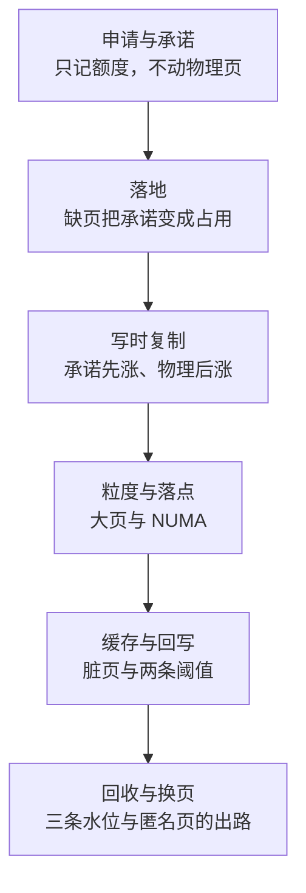
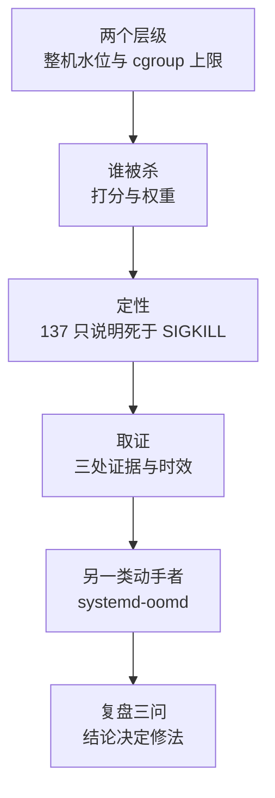
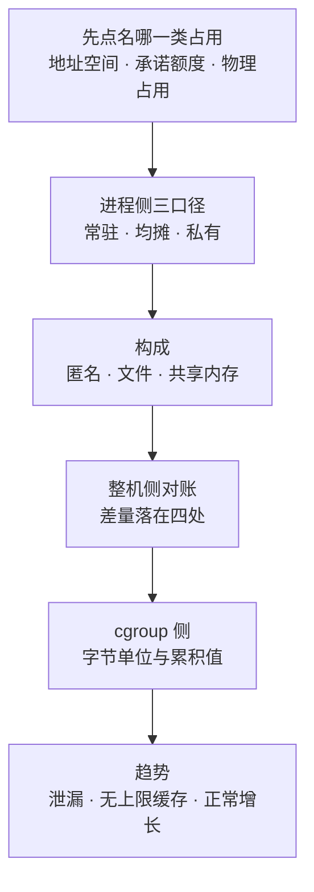
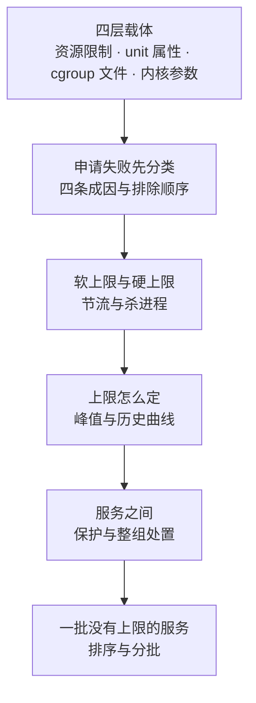
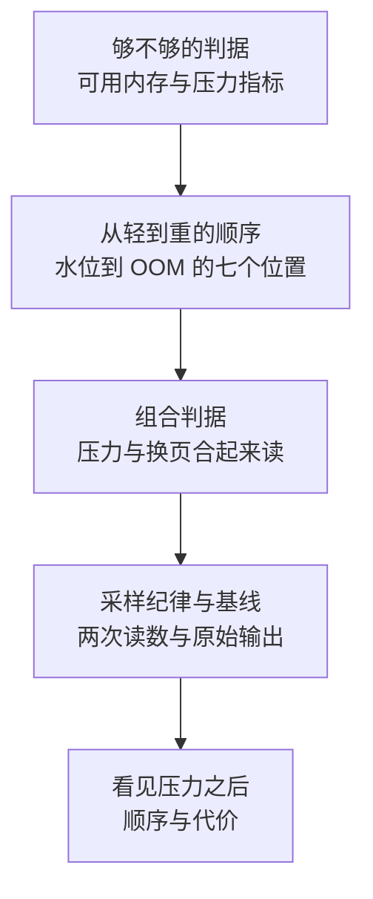

---
tags:
  - Linux
  - 内存
  - OOM
  - 串讲
created: 2026-10-14
---

# 串讲：五条主线

本章正文按建造顺序排列：先机制，再体系，再动手、判断与治理。值班与复盘里的提问不按这个顺序进入——它从一个现象或一个「为什么」开始，回答者需要一条能立刻走下去的路径，并在对方追问时知道拐向哪里。

本篇把全章收成五条主线。它与知识地图的关系是：地图里的一条时间主线在这里拆成两条——一次内存分配的旅程，以及 OOM（Out Of Memory，内核在内存再也回收不出来时按分数挑一个进程杀掉）的定性与取证；后者是时间主线的第五个阶段，因为提问密度高而独立成线。三个跨阶段的核对对象（内存占用的归属、内存上限的载体、内存压力的表现）各自独立成一条。每条主线以一组高频提问为入口，给出沿线的节点顺序；每个节点写四件事：**先答**（第一句先给出的结论）、**举证**（这句话落到哪个字段、文件或命令上）、**深入**（对方再追一层时补上的边界、反例与代价）、**衔接**（问题跨出本节点时拐向哪里）。节点只给骨架：字段的完整读法（是什么、单位、判据、与谁同看、转向哪一步）集中在《观测与基线》第 2 节与「常见故障与排查方向」各场景；被剖析到第 0 层的错误答法在《高频误判》；想验收自己的回答停在哪一层，用《盲区排查》。

## 1. 主线怎么选

| 被问到什么 | 走哪条主线 | 从哪个节点进入 |
| --- | --- | --- |
| 「申请成功了为什么还会被杀」「`malloc` 返回成功算不算内存够」 | 主线一 | 从节点 1 进入 |
| 「`VSZ` 那么大是不是很占内存」「缺页多是不是内存紧张」 | 主线一 | 从节点 1 或节点 2 进入；要报一个数字时先拐主线三节点 1 |
| 「`fork` 之后内存会立刻翻倍吗」「备份进程为什么突然占很多内存」 | 主线一 | 从节点 3 进入 |
| 「大页要不要开」「某个 NUMA 节点先满怎么办」 | 主线一 | 从节点 4 进入 |
| 「缓存占满了要不要清」「写入变慢是不是内存不够」 | 主线一 | 从节点 5 进入；分「设备排队」与「回写限速」时拐主线五节点 3 |
| 「水位线是什么」「后台回收与直接回收差在哪」「`si`/`so` 非 0 要不要 `swapoff`」 | 主线一 | 从节点 6 进入 |
| 「退出码 137 是不是被 OOM 杀了」「`OOMKilled` 这个标签说明什么」 | 主线二 | 从节点 3 进入 |
| 「容器被 OOMKilled，宿主还有很多内存」「`free` 还有余量却 OOM」 | 主线二 | 从节点 1 进入；容器口径拐主线三节点 5 |
| 「谁被杀、为什么是它」「怎么保护关键进程不被杀」 | 主线二 | 从节点 2 进入 |
| 「复盘要回答什么」「事后为什么读不到 `memory.events`」 | 主线二 | 从节点 4 或节点 6 进入 |
| 「这个进程占了多少内存」「所有进程的 RSS 加起来比整机还多」 | 主线三 | 从节点 1 或节点 2 进入 |
| 「内存去哪了、对不上」「`Cached` 涨了说明什么」「`Slab` 很大是不是有问题」 | 主线三 | 从节点 3 或节点 4 进入 |
| 「容器里 `memory.current` 是多少」「容器里 `free` 为什么不准」 | 主线三 | 从节点 5 进入 |
| 「常驻集一直涨是不是泄漏」 | 主线三 | 从节点 6 进入 |
| 「整机还有内存，服务为什么被杀」「改了 `MemoryMax=` 为什么没生效」 | 主线四 | 从节点 1 进入；定性拐主线二节点 1 |
| 「`ENOMEM` 申请失败怎么查」「严格承诺模式要不要开」 | 主线四 | 从节点 2 进入 |
| 「`memory.high` 和 `memory.max` 有什么区别」 | 主线四 | 从节点 3 进入 |
| 「怎么给一个服务定上限」「一批服务没有上限怎么推」 | 主线四 | 从节点 4 或节点 6 进入 |
| 「内存够不够怎么看」「`free` 只剩几百 MiB 要不要加内存」 | 主线五 | 从节点 1 进入 |
| 「压力指标多少算异常」「`wa` 高是不是内存问题」「采样要采几次」 | 主线五 | 从节点 3 或节点 4 进入 |
| 「看见压力之后先做什么」 | 主线五 | 从节点 5 进入 |

## 2. 主线一：一次内存分配的旅程

这条线按时间顺序走：从「申请只记一笔」讲到「匿名页被换出」。时间主线上的第五个阶段独立成主线二，因为 OOM 本身就构成一条完整的提问链；两条线在「内存还有余量却发生了 OOM」这一处相接。

**入口提问**：「申请成功了为什么还会被杀」「`malloc` 返回成功算不算内存够」「`VSZ` 那么大是不是很占内存」「缺页多是不是内存紧张」「`fork` 之后内存会立刻翻倍吗」「备份进程为什么突然占很多内存」「缓存占满了要不要清」「写入变慢是不是内存不够」「水位线是什么、后台回收与直接回收差在哪」「`si`/`so` 非 0 要不要 `swapoff`」「大页要不要开」「某个 NUMA 节点先满怎么办」。

### 2.1 申请只记额度：三条路径与三类占用

- **先答**：`malloc`、`brk` 与 `mmap` 返回成功时，内核只做两件事——把一段虚拟地址划到这个进程名下、按超额分配策略在承诺额度上记一笔，物理页一个都没有分配；因此「申请成功」不能当容量验收，内存不足可能在**任意一次写入**上爆发。
- **举证**：这三件事分属三个类别，看 man 节号就能分清——`malloc` 是 C 库函数（`man 3`），`brk` 与 `mmap` 是系统调用（`man 2`）。落地的路径有三条：`brk` 扩展堆顶、匿名 `mmap`（线程栈、大块 `malloc` 与显式映射）、文件 `mmap`（共享库、文件映射与共享内存），分配器在堆与匿名映射之间切换的阈值是 `M_MMAP_THRESHOLD`（默认值与动态调整区间现场取）。三类占用的字段分别是地址空间 `VmSize`（`ps` 里的 `VSZ`）、承诺额度 `/proc/meminfo` 的 `Committed_AS`、物理占用 `VmRSS` 与 `AnonPages`。
- **深入**：地址空间这一项还有两处边界——映射段数上限 `vm.max_map_count`（该值随发行版与初始化配置变化，现场用 `sysctl` 取），撞上时 `mmap` 返回 `ENOMEM`，报错文本与「内存不够」一模一样，原因却与物理内存无关；栈超过 `RLIMIT_STACK` 时进程得到的是 `SIGSEGV` 而不是 `ENOMEM`。此外承诺额度允许超过「物理内存 + swap」，当前策略用 `sysctl vm.overcommit_memory` 现场取，取 `0` 时是启发式判断、取 `2` 时不允许超额。
- **衔接**：追问「这个进程到底占了多少」拐主线三节点 1；追问「申请失败是什么原因」拐主线四节点 2；「申请成功却很快被杀」拐主线二节点 1。

### 2.2 落地：缺页把承诺变成占用

- **先答**：真正把承诺变成占用的是第一次访问——硬件翻译地址时发现映射无效，触发缺页异常，内核在这一次中断里取一块空闲页（匿名页填零）或把文件页读进来，再更新页表。缺页分两类，代价差一个量级：页已在物理内存里、只缺映射的是 minor fault（次要缺页），页不在内存里、必须从设备或 swap 读入的是 major fault（主要缺页）。
- **举证**：计数在两处，都是累计值、都要取差值——整机看 `/proc/vmstat` 的 `pgfault` 与 `pgmajfault`，单进程看 `/proc/<pid>/stat` 的 `min_flt` 与 `maj_flt`（字段号在 `man 5 proc` 里核对）。运维判据是「`pgmajfault` 的增量持续偏高才是工作集不再驻留内存的证据」，而 `min_flt` 高只说明分配与映射行为活跃。
- **深入**：两处最容易答错的边界——读一个从未写过的匿名页时，内核映射的是内容全零的共享页（零页），只有写入才真正分配，所以缺页次数很多而常驻集几乎不涨；文件页缺页存在缺页放大与预读，因此文件映射的缺页次数通常远小于页数，恰好等于页数反而说明预读被关掉了（例如应用调用了 `madvise(MADV_RANDOM)`）。此外 major fault 也会被冷启动读文件这类正常行为制造出来，所以看的是持续性与伴随指标，不是单次峰值。
- **衔接**：「缺页多是不是内存紧张」在本节点答完；「缺页次数与常驻集的关系」拐主线三节点 3 的构成拆分。

### 2.3 写时复制：承诺先涨、物理后涨

- **先答**：`fork` 不复制内存内容，只复制页表并把这些页在父子两边都标成只读，谁先写谁触发一次缺页、内核此时才复制那一页，这就是写时复制（Copy-On-Write，COW）；因此 `fork` 本身很快、物理内存不会立刻翻倍，但**承诺额度在 `fork` 的瞬间就增加了**。
- **举证**：这条性质落在两处证据上——`fork` 之后子进程的地址空间立刻计入 `Committed_AS`，而父子共享的页在计量上表现为各自的均摊占用（`Pss`）只有原值的一半，因此父子双方的常驻集不能相加。
- **深入**：备份、快照与数据库 `BGSAVE` 这类「`fork` 加大量写」的场景，真实内存需求由 **`fork` 之后写入多少**决定，而不是由进程原本占多少决定；写入还会同时消耗 CPU（用于复制）与内存带宽。COW 不只出现在 `fork`：`MAP_PRIVATE` 的文件映射在写入时也要复制私有副本，透明大页把一组小页合并成大页时同样涉及复制与迁移。
- **衔接**：「`fork` 之后什么时候物理内存才涨」在本节点答完；「备份进程为什么把内存撑起来」拐主线三节点 6 的趋势判断。

### 2.4 落地的粒度与落点：大页与 NUMA

- **先答**：大页改变的是「以什么粒度落地」，NUMA 改变的是「落在哪个节点」，两者都不改申请与回收的机制，只改成本。大页省下的是页表项数量、TLB（Translation Lookaside Buffer，翻译后备缓冲）未命中次数与缺页次数，代价集中在粒度上。
- **举证**：判断大页是否生效看 `/proc/<pid>/smaps_rollup` 的 `AnonHugePages`（整机看 `/proc/meminfo` 的同名字段），**不要用 `VmPTE`**，因为该字段的统计口径随内核版本变化。透明大页（THP，Transparent Huge Pages）的策略在 `/sys/kernel/mm/transparent_hugepage/enabled`，取 `always`、`madvise` 与 `never` 三种值，当前值现场读；多数发行版默认取 `madvise`，因此应用需要显式调用 `madvise(MADV_HUGEPAGE)` 才生效，「我开了大页但没生效」经常只是应用没有给出提示。
- **深入**：三项代价要一起说出——按 2 MiB 粒度落地意味着碰到大页里任意一个字节、整块 2 MiB 就占实，稀疏访问的负载会出现内存放大，而这部分放大在容器里会占掉该 cgroup 的上限；为了凑出连续块，内核可能在缺页路径上同步做内存整理，或由后台线程 `khugepaged` 合并，带来偶发停顿；碎片严重时分配失败并回退到小页，`compact_fail` 与 `thp_fault_fallback` 一类计数上升是它的信号。NUMA（Non-Uniform Memory Access，非统一内存访问）一侧的判据是 `numastat` 的 `numa_miss` 与 `numa_foreign` 高而本地命中比例低；`taskset` 只绑 CPU 不绑内存，落点要由 `numactl --membind` 或 `--interleave` 决定，自动平衡由 `kernel.numa_balancing` 控制，当前值现场取。
- **衔接**：「内存总量没满但某个节点先满」拐主线五节点 2 的顺序判据；容器里的 NUMA 视图受 `cpuset.mems` 约束，属于治理口径，见主线三节点 5。

### 2.5 缓存与回写：缓存是资产，写变慢通常是回写跟不上

- **先答**：内核把空闲内存用来缓存文件内容，所以「完全空闲很少」通常说明这台机器正在用内存缓存文件内容，而不是内存不够；写入变慢的根因多数不在内存不足，而在脏页的产生速率与设备的排空速率不匹配——脏页超过硬阈值后，发起写的进程会被限速甚至阻塞，现象是 `wa` 高、设备 `await` 高、进程进入 `D` 状态，而**内存并不缺**。
- **举证**：字段都在 `/proc/meminfo`，单位 kB——`Cached` 是页缓存总量并且**包含 `Shmem`**（tmpfs 与共享内存的页也算缓存），`Dirty` 与 `Writeback` 分别是已改未落盘与正在落盘的页，`SReclaimable` 与 `SUnreclaim` 分别是可回收与不可回收的内核对象，只有后者才是长期占用。两条阈值由 `vm.dirty_background_ratio` 与 `vm.dirty_ratio`（或等价的字节数版本 `vm.dirty_background_bytes` 与 `vm.dirty_bytes`，两族互斥）给出，当前值现场用 `sysctl` 取。
- **深入**：两处边界——阈值只决定「何时开始回写」与「何时开始限速写者」，不决定设备能否跟上，因此设备本身够快时把上限调小并不会让写变快；`drop_caches` 丢掉的是干净缓存与可回收 slab，此后业务必须为重建缓存付出 IO，它只用于「需要一把干净读数」的测量场景，**生产上不要执行**。真正需要治理的只有两类：脏页长期积压，以及缓存无法回收（例如 tmpfs 占用了大量 `Shmem`，它不随压力被丢弃）。
- **衔接**：「是设备排队还是回写限速」拐主线五节点 3 的组合判据；「内存去哪了」里属于共享内存的那一份拐主线三节点 4。

### 2.6 回收与换页：三条水位与匿名页的出路

- **先答**：空闲页低于三条警戒线（`min`、`low`、`high`）时回收启动，有两条路径——后台回收由内核线程 `kswapd` 执行，直接回收由发起分配的进程自己执行。内核按最近有没有被访问把页排在 LRU（Least Recently Used，最近最少使用）链表上并从冷端挑：文件页有文件对应，可以直接丢掉、下次用到再读回来，回收成本低；匿名页没有文件对应，只能写入 swap，回收成本高。
- **举证**：三条水位在 `/proc/zoneinfo` 里按内存区列出，**单位是页数而不是 kB**，要与同文件的 `pages free` 对照着读并乘页大小换算；`vm.min_free_kbytes` 决定 `min` 线，`vm.watermark_scale_factor` 决定 `low` 与 `high` 相对 `min` 的间距，两者都用 `sysctl` 现场取。直接回收正在发生的证据是 `/proc/vmstat` 的 `allocstall` 增长，配合 `workingset_refault` 增长则说明刚回收的页马上又被用到，即回收判断与实际工作集不匹配。
- **深入**：`vm.swappiness` 是回收时对匿名页的**倾向权重**而不是开关，取值 0~200（内核 ≥5.8 起），即使设为 0，压力大时也可能换页；要彻底不用 swap 只能 `swapoff`，或把该 cgroup 的 `memory.swap.max` 设为 0。关掉 swap 不会消除风险，只是把「换页变慢」换成「被 OOM 杀掉」。swap 可以是分区也可以是文件，文件形式的链路是先 `fallocate` 划出空间、再用 `mkswap` 写入签名、最后用 `swapon` 启用；两处边界是带空洞的文件不能被 `swapon` 接受，Btrfs 上 `fallocate` 出来的文件也不能直接用作 swap。内核还有两种压缩换空间的变体：zram 把换出的页压缩后放在内存里，zswap 在写往真实 swap 之前先压缩缓存一层，两者都不减少内存压力这个事实，只是把代价从 IO 换成 CPU。
- **衔接**：「`si`/`so` 非 0 要不要 `swapoff`」拐主线五节点 3 与节点 5；「内存还有余量却 OOM」拐主线二节点 1。

## 3. 主线二：OOM 的定性与取证

这条线从时间主线的第五个阶段拆出，按「谁杀的、为什么是它」走：先分层级，再定人，再取证，最后落到复盘要回答的三个问题。

**入口提问**：「退出码 137 是不是被 OOM 杀了」「容器被 OOMKilled，宿主还有很多内存」「`free` 还有余量却 OOM」「谁被杀、为什么是它」「怎么保护关键进程不被杀」「`OOMKilled` 这个标签说明什么」「复盘要回答什么」「事后为什么读不到 `memory.events`」。

### 3.1 两个层级：整机 OOM 与 cgroup OOM

- **先答**：OOM 分两个层级，判据完全不同——整机 OOM 发生在物理内存与 swap 都用不出来时，内核从全局挑一个进程杀掉；cgroup（控制组）OOM 发生在某个 cgroup 撞到自己的上限 `memory.max` 时，**此时整机内存可能还很充裕**，容器化环境里绝大多数 OOM 属于这一类。
- **举证**：定层级的第一手证据是内核日志（`dmesg -T` 或 `journalctl -k`）里的措辞——整机级打印 `invoked oom-killer` 与 `Out of memory: Killed process`，cgroup 级额外带 `constraint=CONSTRAINT_MEMCG`、`oom_memcg=<路径>` 与 `Memory cgroup out of memory`；其中 `oom_memcg=` 给出的路径就是复盘时要去读计数文件的那个 cgroup。
- **深入**：被选中进程那一行还带着 `total-vm`、`anon-rss`、`file-rss`、`shmem-rss`（单位 kB）与 `pgtables`，其中 `anon-rss` 大说明这是应用自己的内存；`oom_score_adj` 非默认值说明有人手动调过。这条判据的边界是环境：容器被 OOM 杀时可能只有 cgroup 记录而没有整机日志，日志的字段与措辞在别的内核与发行版上会变，因此靠关键词匹配的判据要现场核对。
- **衔接**：「宿主还有 5 GiB，Pod 为什么被 OOMKilled」拐主线三节点 5；「撞的是哪一层上限」拐主线四节点 1。

### 3.2 谁被杀：打分与权重

- **先答**：内核按 `oom_badness` 打分挑进程，主要看该进程占用的内存量，再叠加 `oom_score_adj`（取值范围 -1000~1000，越小越不容易被杀）。
- **举证**：单个进程的当前分数从 `/proc/<pid>/oom_score` 读（只读），可写的调整量是 `/proc/<pid>/oom_score_adj`。
- **深入**：保护关键进程（SSH、systemd、监控代理）的做法是给它们更低的 `oom_score_adj`，或者给业务加限制，而**不是只调别人的分数**——调高别人的权重只改变内核挑中谁的概率，影响面不可控，而限制是边界。这条差别在治理上的含义是：优先用 cgroup 做隔离，而不是用权重做概率调整。
- **衔接**：给服务配上限的完整走法在主线四节点 1 与节点 4；「两个服务互相拖累」拐主线四节点 5。

### 3.3 定性：137 只说明死于 `SIGKILL`

- **先答**：退出码 137 等于 `128 + 9`，它只回答「怎么死的」，不回答「谁干的」——人工 `kill -9`、停止超时后的强杀、编排层或健康检查触发的重启同样产生 137；定性要看三处证据。
- **举证**：第一处是内核日志里的 OOM 记录（整机或 cgroup，字段见节点 1）；第二处是该 cgroup 的计数文件 `memory.events` 的 `oom` 与 `oom_kill`，两者都是**该 cgroup 创建以来的累积值，必须用两次读数的差值判断「这次」**，同时看 `memory.peak` 是否贴着 `memory.max`；第三处是人工操作与编排层的重启记录，这一步常被跳过，却是排除误判的关键。
- **深入**：三处都不命中时，结论应写成「死于 `SIGKILL`，来源待查」，而把 137 直接写成 OOM 是复盘里最常见的一处失真。此外 139 与 134 分别指向 `SIGSEGV` 与 `SIGABRT`，方向是 `coredumpctl list` 与内核的段错误记录。
- **衔接**：「`OOMKilled` 只是一个标签」拐主线四节点 3；证据的采集顺序与代价拐主线五节点 5。

### 3.4 时效：计数文件会随单元结束消失

- **先答**：cgroup 目录会随单元结束被回收，`memory.events` 这类计数只在存活期间存在；systemd 服务单元的 `OOMPolicy` 默认是 `stop`，因此一次 cgroup OOM 会把整个单元停掉，cgroup 与其中的计数文件一起消失。
- **举证**：要在 OOM 之后复盘现场，要么把 `OOMPolicy` 显式设成 `continue`（该属性要求 systemd ≥243），要么提前把 cgroup 文件采下来；判断当前生效值用 `systemctl show` 读该属性，不要凭文档。
- **深入**：因此「服务已自动恢复」不构成跳过取证的理由——恢复的是服务，消失的是证据。同一类时效问题也出现在内核环缓冲上：未持久化的日志重启即失，而事后按关键词去搜时往往已经被覆盖。
- **衔接**：「事后去读 `memory.events` 什么也读不到」是本节点的典型形态；复盘产物的字段见节点 6。

### 3.5 另一类动手者：`systemd-oomd`

- **先答**：`systemd-oomd` 是用户态的 OOM 守护进程，它基于 cgroup v2 与压力指标（PSI，Pressure Stall Information，压力停顿信息）在「压力很大但还没 OOM」时提前动手，配置在 `oomd.conf`。
- **举证**：它的动作与内核 OOM 在日志里长得不一样，因此排查时要先确认是哪一个动的手——先在内核日志里找 OOM 记录，找不到再去查 `systemd-oomd` 的日志与配置。
- **深入**：与之配套的是 `memory.high` 这条软上限，它只做节流（回收与限速）而不杀进程，所以「压力被压住了但没有进程死」也可能是它在起作用；两类动作在证据上的差别是看 `memory.events` 里 `max` 与 `oom_kill` 各是多少，而不是只看进程死没死。
- **衔接**：本节点只负责「是谁动的手」，怎么配、配在哪一层拐主线四节点 3。

### 3.6 复盘三问与结论分流

- **先答**：OOM 复盘至少要回答三个问题——谁被杀（进程名、cgroup 与当时的用量）、为什么是它（权重是多少，它是 cgroup 里最大的那个还是在整机层面被选中）、撞的是谁的上限（整机水位还是某个 cgroup 的 `memory.max`）；这三者对应完全不同的修法。
- **举证**：结论只有三种，必须落到其中一种——配额过紧则回滚或调整上限，依据是 `memory.peak` 与业务增长趋势；应用峰值超出预期则优化或扩容，因为配额只是暴露了问题；页缓存计入额度（`memory.stat` 的 `file` 占大头）则看访问模式，可能要给缓存留余量而不是加限制。
- **深入**：产出一份 OOM 复盘记录，其中写清三问的答案，并附回滚动作与后续观察窗口；「结论属于哪一类」这一栏不能留空，因为「配额过紧」与「应用异常增长」的后续动作完全相反，写错会让同一个问题在下一周重演。
- **衔接**：上限该定多少拐主线四节点 4；「谁被杀」的字段读法回到节点 2。

## 4. 主线三：占用口径——「占了多少」没有唯一答案

这条线对应知识地图里的第一个跨阶段的核对对象「内存占用的归属」，它贯穿全部五个阶段，因为申请、落地、缓存、回收与 OOM 都会改变某一类占用的数值。它按「数字的口径」走：同一个量能有好几个合法的数，答错口径比答错数值更常见。

**入口提问**：「这个进程占了多少内存」「所有进程的 RSS 加起来比整机还多」「内存去哪了、对不上」「`Cached` 涨了说明什么」「`Slab` 很大是不是有问题」「`used` 这一列到底怎么算」「常驻集一直涨是不是泄漏」「容器里 `memory.current` 是多少」。

### 4.1 「占了多少」先点名是哪一类占用

- **先答**：被问「占了多少内存」时，正确的第一个动作是反问要回答什么问题，因为这句话落到三类不同的量上——地址空间（`VmSize`，`ps` 里的 `VSZ`）回答「要了多少虚拟地址」，承诺额度（`/proc/meminfo` 的 `Committed_AS`）回答「内核按策略答应了多少」，物理占用（`VmRSS`、`AnonPages`、`PageTables`）回答「内存条上真的被占了多少」。
- **举证**：三类量可以相差几个数量级，`VSZ` 很大而常驻集很小是常态——线程栈预留、按最大堆预留、大文件映射都会把地址空间撑大，而它们并不落在物理内存上。因此告警口径也要先问清是哪一类，很多「内存使用率」把缓存也算进去了。
- **深入**：承诺额度这一类还有一条容易用错的边界——内核允许「承诺总量大于物理内存加 swap」，在 `vm.overcommit_memory` 取 `0` 与 `1` 时这是设计允许的，只有取 `2` 时 `CommitLimit` 才是硬约束，因此拿 `Committed_AS` 与物理内存比大小做容量告警会得出错误结论。
- **衔接**：「`VSZ` 32 GiB 是不是很占内存」在本节点答完；三类量在申请与落地两个时刻的分离拐主线一节点 1 与节点 3。

### 4.2 进程侧三口径：常驻、均摊、私有

- **先答**：进程侧有三种计量口径，各自回答不同的问题——常驻集（RSS，Resident Set Size；字段是 `VmRSS`）统计常驻物理页并**把共享页对每个使用者重复计数**，回答「谁看起来最大」；均摊（PSS，Proportional Set Size；字段是 `Pss`）把共享页按使用者数量分摊，回答「这台机器上真正被谁用了」；私有口径（`Private_Clean` 与 `Private_Dirty` 之和）只算私有页，回答「杀掉它能省多少」。
- **举证**：三者都从 `/proc/<pid>/smaps_rollup` 读，常驻集还可以从 `/proc/<pid>/status` 的 `VmRSS` 与 `ps -o rss` 读。由此得到三条实务规则：容量报表要用均摊或私有口径；判断「杀它能省多少」要用私有口径，因为共享库与共享内存杀了也省不下来；**不要把各进程的常驻集相加**，因为和一定大于物理内存。
- **深入**：私有口径在工具侧还有一处口径差——内核没有 `Uss` 这个字段，`ps -o uss` 给的是 `Private_Clean` 与 `Private_Dirty` 之和。另外同一线程组内各线程的 `VmRSS` 本来就是同一个数，因此按线程相加会得到成倍偏大的结果。
- **衔接**：「所有进程的 RSS 加起来比整机还多」拐节点 4 的对账；「常驻集一直涨」拐节点 6。

### 4.3 常驻集的构成决定方向

- **先答**：常驻集按页的类型可以拆成三项，涨在哪一项决定处置方向——`RssAnon` 是匿名页，涨了说明增长来自应用数据、缓冲池或泄漏；`RssFile` 是文件页，涨了说明读了文件或映射了大文件，这部分在压力下可回收；`RssShmem` 是共享内存与 tmpfs 占用的页，涨了说明有人在写 tmpfs 或用共享内存。
- **举证**：三个字段都在 `/proc/<pid>/status`，同文件还有 `VmSwap` 说明有多少已被换出；容器里改看该 cgroup 的 `memory.stat` 的 `anon`、`file` 与 `slab`。
- **深入**：`RssFile` 占大头时常驻集很大也可以不是问题，因为可回收的那部分不构成容量风险；反过来，`Cached` 里包含 `Shmem`，因此把共享内存类增长当成普通缓存会漏掉一个不会随压力释放的项。
- **衔接**：「内存去哪了」里属于共享内存与 tmpfs 的那一份拐节点 4；「容器里 `memory.stat` 的 `slab` 偏高」拐主线四节点 1。

### 4.4 整机侧对账：差量落在四处

- **先答**：把进程的常驻集相加与整机用量对不上时，差量通常来自四处——共享页重复计数（因此相加必然偏大）、tmpfs 与共享内存（`Shmem`，它占内存而不占磁盘，因此 `df` 与 `du` 都容易漏）、内核对象（`SUnreclaim`、`PageTables` 与 `KernelStack`）、以及容器场景里被 cgroup 计入组内的页缓存。
- **举证**：做法是拿 `/proc/meminfo` 逐项对账，而不是只看进程；对应字段是 `Shmem`、`SUnreclaim`（要与可回收的 `SReclaimable` 分开看）、`PageTables` 与 `KernelStack`，单位都是 kB。
- **深入**：两条边界——`SReclaimable` 与 `SUnreclaim` 分开看之前，「`Slab` 很大」这句话没有意义，因为只有不可回收的那部分才是长期占用；差量随时间单调上涨而 `Shmem` 与 `SUnreclaim` 都没动时，方向要改回进程侧，按 `RssAnon` 的趋势找增长源。对账要求两次带时间戳的同口径读数，这是时间成本，换来的是能区分瞬时差量与持续差量。
- **衔接**：「对不上就先加内存」是本节点最要避开的动作；`free` 的 `used` 列口径随 procps 版本变化，对账时用 `/proc/meminfo` 现场算一遍，见主线五节点 1。

### 4.5 cgroup 侧的口径：字节单位与累积值

- **先答**：容器或服务的用量记在它自己的 cgroup 文件里，不在整机视角里——`memory.current` 是当前用量，`memory.max` 是硬上限（取 `max` 表示没有上限），`memory.peak` 是历史峰值；这些文件的**单位是字节，不是 kB**。
- **举证**：`memory.stat` 给出构成，`anon`、`file` 与 `slab` 分别对应应用内存、页缓存与内核对象，决定处置方向；`memory.events` 给出事件计数，`oom` 是触发判定的次数、`oom_kill` 是真正杀掉的次数、`max` 是撞上限被回收或节流的次数，**三者都是累积值，要取差值判断「这次」**。
- **深入**：一条容易读错的换算——`536870912` 是 512 MiB，因为要除以 1024 两次；一条容易误判的组合是 `max` 非 0 而 `oom_kill` 为 0，它说明撞过上限但每次都靠回收或节流化解了，没有真的杀进程。此外容器的额度还受三处影响：页缓存计入容器、页表与内核栈同样计入、`/dev/shm` 有自己的大小上限（很多环境默认很小，现场用 `df -h /dev/shm` 确认，写满时报的是 `ENOSPC`，而它与磁盘满不是一回事）。
- **衔接**：「容器里 `free` 为什么不准」——容器内读到的 `/proc/meminfo` 仍是宿主的值，容器自己的额度与用量要看本节点的字段，因此那条判据在容器内不成立；「容器被 OOMKilled 宿主却很空」拐主线二节点 1。

### 4.6 趋势：泄漏、无上限缓存与正常增长

- **先答**：判断「常驻集缓慢上涨」属于哪一类，要看构成与形状两件事——构成按节点 3 拆开；形状上，阶梯式上涨且重启后重演才像泄漏或无上限缓存，呈平台期或与请求量同比例增长的更像正常增长。
- **举证**：采样要同一口径、带时间戳、按小时或按天取，判断抖动才按秒；容器里改看 `memory.current` 与 `memory.stat` 的构成。
- **深入**：单次 `top` 与单次快照都不能作为依据，因为缓存会涨落、业务有峰谷，一次读数无法区分「持续上涨」与「刚处理完一批数据」。区分之后处置完全不同：泄漏要改代码或灰度重启，那是应用侧的事，运维侧的止损是限制上限并留证；无上限缓存则先把缓存上限设住，用一次配置排除这一支。
- **衔接**：「缓慢增长一定是泄漏」与「一定是正常缓存」这两种说法都缺证据；先限制后处置的顺序与代价拐主线五节点 5。

## 5. 主线四：上限的载体——上限写在哪一层

这条线对应知识地图里的第二个跨阶段的核对对象「内存上限的载体」，它贯穿阶段 ① 与阶段 ⑤，因为额度在申请时记上，而撞上限发生在回收不动之后。它按「上限写在哪一层」走：载体不同，改配置的地方、撞上之后的命运与验收方式都不同。

**入口提问**：「整机还有内存，服务为什么被杀」「改了 `MemoryMax=` 为什么没生效」「`ENOMEM` 申请失败怎么查」「严格承诺模式要不要开」「`memory.high` 和 `memory.max` 有什么区别」「怎么给一个服务定上限」「一批服务没有上限怎么推」。

### 5.1 四层载体

- **先答**：一个进程的内存上限可以写在四层，而四层的**载体不同**，因此查文档和改配置的地方也不同——进程自身是资源限制（`RLIMIT_AS` 与 `RLIMIT_DATA`，由 `setrlimit(2)` 或 shell 的 `ulimit` 设置）、服务单元是 systemd 属性（unit 文件里的 `MemoryHigh=` 与 `MemoryMax=`）、cgroup 是内核接口文件（`memory.high` 与 `memory.max`，直接读写）、整机是内核参数与水位（`vm.min_free_kbytes` 一类，用 `sysctl` 查看与设置）。
- **举证**：四层各自独立生效，因此「服务被限制杀死」与「整机内存不足」是两回事。撞上之后的表现也不同——进程自身的限制撞上时申请失败并返回 `ENOMEM`，进程可能直接报错退出；unit 与 cgroup 的软线只做节流，硬线触发该 cgroup 内的 OOM；整机这一层触发整机 OOM，内核从全局挑进程杀掉。
- **深入**：给服务配上限的意义在于把故障限制在一个服务内，而不是让它拖垮整机——**内存上限首先是可用性手段**。与之相对，没有上限的服务可以把整机内存用尽，把「一个服务变慢」放大成「整机不可用」；上限与容量规划是一对互补手段，只做其中一件会稳定地出问题。
- **衔接**：「整机还有内存，服务为什么被杀」拐主线二节点 1；「上限该定多少」拐节点 4。

### 5.2 申请失败的四条成因与排除顺序

- **先答**：`malloc` 返回 `NULL`（库函数约定）与 `mmap` 返回 `-1` 并把 `errno` 置成 `ENOMEM`（系统调用约定）都表示申请失败，但不一定是物理内存没了；按四条成因依次排除，**其中三条与内存条上还剩多少无关**。
- **举证**：排除顺序是——第一，严格承诺撞上限，只在 `vm.overcommit_memory` 取 `2` 时出现，特征是 `/proc/meminfo` 的 `Committed_AS` 贴着 `CommitLimit`；第二，该进程自己的地址空间限制，读 `/proc/<pid>/limits` 里地址空间与数据段两项的软值与硬值；第三，映射段数上限，把 `sysctl vm.max_map_count` 与 `/proc/<pid>/maps` 的行数对比（行数是当前 VMA（Virtual Memory Area，虚拟内存区域）的数量）；第四，前三条都不命中且伴随 OOM 记录、压力指标与换页时，那才是真的没有内存。
- **深入**：两处边界——只有严格承诺模式下 `CommitLimit` 才是硬约束，因此拿它做容量告警在另外两种模式下会得到错误结论；`vm.max_map_count` 的值随发行版与初始化配置变化，必须现场取，照抄一个数字去比就失效。另外不要为了「避免 OOM」把承诺策略改成严格模式，那只是把「某个进程被杀」换成「新申请直接失败」，而后者对需要频繁启动新进程的服务更难恢复；改之前要算清 `CommitLimit`、峰值 `Committed_AS` 与余量，模式 2 下还有 `admin_reserve_kbytes` 与 `user_reserve_kbytes` 两个保留量，默认值现场取。
- **衔接**：「申请成功却很快被杀」是这条性质的反面，拐主线一节点 1 与节点 3。

### 5.3 软上限与硬上限：节流与杀进程

- **先答**：`memory.high` 与 `memory.max` 是两种命运——前者是软上限，超出后只做节流（回收与限速），进程继续运行；后者是硬上限，撞上就触发该 cgroup 的 OOM，会有进程被杀。
- **举证**：systemd 侧的对应属性是 `MemoryHigh=` 与 `MemoryMax=`，此外还有 `MemorySwapMax=` 对应 `memory.swap.max`、`MemoryAccounting=` 打开记账（服务单元的默认值是开启，现场用 `systemctl show` 核对）。
- **深入**：给延迟敏感的服务先上 `high` 通常比直接上 `max` 更安全，但它拦不住真正失控的服务，因此「只设了 `high` 就以为会被保护」是一条常见的坑。判断当前撞的是哪一条，要看 `memory.events` 里 `max` 与 `oom_kill` 的差值组合，而不是只看进程死没死。
- **衔接**：「`OOMKilled` 只是一个标签」——它要区分撞的是 `memory.max` 还是整机水位，前者是配额问题、后者是容量或邻居问题，定性回到主线二节点 1 与节点 6。

### 5.4 上限该定多少：用峰值与历史曲线

- **先答**：上限不是拍出来的，依据是 `memory.peak` 与历史曲线给出的真实峰值，再乘安全系数给初值，上线后按新峰值复核；不能用「邻居服务是多少」或「看着差不多」来定。
- **举证**：给新服务定上限的完整动作是——以压测峰值乘系数给初值，上线后用 `memory.peak` 复核，再按真实峰值重新校准；产出是一条带依据的记录，写明服务名、cgroup 路径、初值及其依据、复核时间与复核方法、回滚方式。
- **深入**：上限调小之后服务开始被 OOMKilled 时，结论只有三种且必须落到一种——配额过紧则回滚或调整上限（依据是峰值与业务增长趋势）；应用峰值超出预期则优化或扩容（配额只是暴露了问题）；页缓存计入额度则看访问模式（可能要给缓存留余量而不是加限制）。把上限一次性压到峰值以下属于不可做的动作，它把一次可回滚的配置变更变成了一次服务中断。
- **衔接**：「改小上限之后服务被 OOMKilled」的取证与结论分流拐主线二节点 6。

### 5.5 服务之间互相拖累：保护与整组处置

- **先答**：同一节点上 A 服务突发把内存用紧、B 服务开始换页时，正确的做法是用 cgroup 做隔离——给 A 设 `memory.max` 把它限制在自己那一格，给 B 设 `memory.low` 让回收时尽量不动它。
- **举证**：若 A 是多进程组，就考虑 `memory.oom.group`，它取 1 时 OOM 终结整个 cgroup 而不是单个进程；**优先用 cgroup 做隔离，而不是调 `oom_score_adj` 去改变内核挑中谁的概率**，因为后者只是概率，前者是边界。
- **深入**：产出是隔离方案与验证方式，也就是各自的上限、保护设置，以及「压力下 B 是否还在换页」的复查步骤；没有复查步骤的隔离方案无法验收，因为无法证明压力真的被限制在了一格之内。
- **衔接**：「怎么保护关键进程」与主线二节点 2 是同一件事的两面：那边讲权重为什么不够，这边讲边界怎么划。

### 5.6 一批服务没有上限：排序与分批

- **先答**：巡检发现一批服务没有上限时，按「峰值内存乘以影响面」排序推进，先做核心链路与内存大户；每个服务先补一次只读基线（峰值、构成、压力），再分批改上限，每批改完留观察窗口。
- **举证**：不要一次性批量改，因为几十个服务的上限同时生效等于把几十个未知风险同时引入，出了问题无法归因；产出是一张排期表（服务、当前峰值、目标上限、影响面、批次、验证方式）与每批的变更记录。
- **深入**：排期表的每一行都要有验证方式与回滚命令，因为上限调整属于生产变更。「默认有界」是行业通行的方向——新服务上线就带内存上限，而不是等出事再补；上限还要随负载变化定期复核，否则基线会随时间失效。
- **衔接**：「上限改完怎么验收」的唯一依据是进程实际生效的值——`/proc/<pid>/limits` 读软值与硬值，cgroup 侧读 `memory.current` 与 `memory.max` 的关系，完整口径在《盲区排查》第 9 节。

## 6. 主线五：内存压力的表现——从变慢到被杀

这条线对应知识地图里的第三个跨阶段的核对对象「内存压力的表现」，它贯穿阶段 ③ 到阶段 ⑤，因为压力先表现为回写变慢，再表现为回收与换页，最后才走到 OOM。它按「怎么在被杀之前先看见变慢」走。

**入口提问**：「内存够不够怎么看」「`free` 只剩几百 MiB 要不要加内存」「压力指标多少算异常」「`wa` 高是不是内存问题」「`si`/`so` 非 0 要不要 `swapoff`」「`vmstat` 第一行能看吗」「采样要采几次」「看见压力之后先做什么」。

### 6.1 「够不够」的判据：可用内存与压力指标

- **先答**：「这台机器内存够不够」的判据是 `/proc/meminfo` 的 `MemAvailable`（`free` 里的 `available` 列）与 `/proc/pressure/memory`，不是完全空闲那一列；`free` 小通常说明这台机器正在用内存缓存文件内容，而不是内存不够。
- **举证**：`MemAvailable` 由内核估算，把可回收的页缓存按低水位打折后算作可用，单位 kB；`/proc/pressure/memory` 给出 `some` 与 `full` 两条，前者的含义是「至少有一部分任务因为内存而停等」，后者是「所有可运行任务都被拖住」，`avg10`、`avg60` 与 `avg300` 是三个时间尺度上的占比（单位是百分比），`total` 是自开机以来的累计停滞时间（单位微秒），要取差值。
- **深入**：两处边界——`free` 的 `used` 列口径随 procps 版本变化，老版本约等于「总量减完全空闲减缓冲缓存」，较新版本更接近「总量减可用」，因此对账要回 `/proc/meminfo` 现场算；`Cached` 里包含 `Shmem`，tmpfs 与共享内存的页不随压力被丢弃，因此在 `Shmem` 占用大的机器上，`MemAvailable` 的依据与实际可回收量之间会出现一个缺口。
- **衔接**：「`free` 只剩几百 MiB 业务却正常」在本节点答完；「压力大到什么程度」拐节点 2。

### 6.2 从轻到重的顺序：水位到 OOM 的七个位置

- **先答**：压力从轻到重是一条固定的链——空闲页低于水位、后台回收、直接回收、换页与回写、压力指标上升、major fault 增加，最后才到 OOM；**能看见变慢，就有机会在中断之前动手**。
- **举证**：每一段都有对应字段——水位在 `/proc/zoneinfo` 里按内存区以页数给出，要与 `pages free` 对照；直接回收的证据是 `/proc/vmstat` 的 `allocstall` 增长；换页与回写看 `vmstat` 的 `si`、`so` 与 `wa`，以及 `/proc/meminfo` 的 `Dirty` 与 `Writeback`；压力指标看 `/proc/pressure/memory`；major fault 看 `/proc/vmstat` 的 `pgmajfault` 增量；OOM 看 `memory.events` 的 `oom` 与 `oom_kill` 差值。
- **深入**：三处容易读错的地方——`vmstat` 的 `b` 列是瞬时计数，单行等于 1 可能只是噪声或一次 IO 脉冲，连续多行都有值才算确实有进程卡在不可中断睡眠里，而且它只回答「有没有进程在等」，不回答「谁在等什么」；`vmstat` 与 `iostat` 的第一行是自开机以来的平均值，脚本取数必须跳过；水位线单位是页数而不是 kB，一台机器可能有多个内存区，要分别看。
- **衔接**：「怎么在被杀之前先看见变慢」在本节点答完；「压力来自内存还是 IO」拐节点 3。

### 6.3 组合判据：压力与换页合起来读

- **先答**：判断内存压力要按组合读，不能只看一列——压力指标三个尺度都接近 0 且 `si`/`so` 为 0 属于没有压力；`some` 抬头而 `si`/`so` 偶发非 0 属于有压力但还没形成持续换页；三个尺度同时抬头、`si` 与 `so` 同时持续非 0 且 `pgmajfault` 增长才是典型的内存紧张；**压力指标高、`wa` 高而 `si`/`so` 为 0 属于压力来自 IO 而不是内存**，方向要转到设备与写模式。
- **举证**：换页这一支还要看是谁被换出——`ps -eo pid,comm,rss --sort=-rss` 定位占用大户，`/proc/<pid>/status` 的 `VmSwap` 说明它有多少已被换出。回写这一支的判据是 `Dirty` 与阈值的距离加上设备侧的 `await` 与 `aqu-sz`——`Dirty` 贴着阈值而 `await` 不高说明瓶颈是回写限速，`Dirty` 离阈值有距离而 `await` 与 `aqu-sz` 都高说明是设备排队或写模式问题。
- **深入**：两处边界——`si`/`so` 只有在该机配了 swap 时才有意义，没有 swap 的机器上它们恒为零，这条判据要用压力指标与 `pgmajfault` 代替；`allocstall` 增长伴随 `workingset_refault` 增长说明分配者被迫回收、刚回收的页马上又被用到，此时方向是评估容量或调整回收倾向，而不是继续调小脏页上限。
- **衔接**：「写入变慢是不是内存不够」在本节点分流；「`si`/`so` 非 0 要不要 `swapoff`」拐节点 5 的代价判断。

### 6.4 采样纪律与基线

- **先答**：内存问题几乎没有「看一眼就定性」的，因此采样有四条纪律——同一口径、带时间戳、至少两次、留原始输出。
- **举证**：判断抖动按秒，判断泄漏按小时或按天；整份 `/proc/meminfo` 与相关 cgroup 文件都要存下来，而不是只抄一个数字，因为复盘时经常需要当时没注意的字段。基线卡最少要记录发行版与内核版本、`MemTotal` 与 `MemAvailable`、压力指标三个尺度、swap 配置、水位与回写参数、大页策略、cgroup 版本，以及内存占用前几名及其口径。
- **深入**：**在没有基线的机器上，「内存使用异常」这个判断本身就不成立**，因为没有「正常」可对照；压力指标也没有通用阈值，可操作的起步判据是「`some` 长期非 0 且 `avg60` 抬头」与「`full` 非 0」，具体数值要和自己机器的基线比。起步判据只能用来决定要不要继续看，不能用来定性。
- **衔接**：「同事说这台机器内存不够，前三步是什么」在《观测与基线》第 2 节与「常见故障与排查方向」场景一里；本节点只给纪律。

### 6.5 看见压力之后：顺序与代价

- **先答**：动作要按可逆性排序——只读采集（`free`、`/proc/meminfo`、`/proc/pressure/*`、`vmstat`）在生产机上可以先做完；改回写参数、减 swap、调上限属于生产变更，要有基线与回滚命令才能动；重启与扩容能立刻止血，但代价分别是「冲掉现场」与「掩盖真实成因」，所以两支都排在取证之后。
- **举证**：两类动作的代价要具体说出来——`drop_caches` 能立刻让读数变好，代价是让业务为重建缓存付出 IO，它的正当用途只有「需要一把干净读数」的测量场景；关掉 swap 把「换页变慢」换成「被 OOM 杀掉」，所以它排在缩小工作集与扩容之后。
- **深入**：三处难恢复的动作要单独点名——把硬限制调低在无特权时不可逆，同一个进程内升不回去，只能重启；`swapoff` 之后没有缓冲，同样的压力下更容易走到 OOM；重启是唯一能确定毁掉现场的动作，必须放在最后。若影响面还在扩大，就先做可逆的止损动作（摘流量、限制上限）把业务拉回来，但动手之前记下当时读到的数字。
- **衔接**：「一份合格的回答应当包含结论、依据、边界与动作」四要素的样板在《观测与基线》「常见故障与排查方向」各场景；「回答停在哪一层」用《盲区排查》第 3 至第 9 节逐层对照。

## 7. 主线之间的接口

被追问得最多的问题，恰好落在两条主线的接缝上。下表给出接缝处的走法——先说清衔接本身，就是回答的一部分。

| 被问到的问题 | 它落在哪两条主线的接口上 | 怎么走 |
| --- | --- | --- |
| 「整机还有内存，服务却被杀了」 | 主线二的「两个层级」与主线四的「四层载体」 | 先走主线二节点 1，用内核日志的 `constraint=CONSTRAINT_MEMCG` 与 `oom_memcg=` 确认撞的是 cgroup 层；再走主线四节点 1 说明这个上限写在哪一层、改哪里才生效 |
| 「`free` 还有余量却发生了 OOM」 | 主线五的「够不够的判据」与主线二的「两个层级」 | 先走主线五节点 1 确认整机侧确实没有压力；再走主线二节点 1 说明撞的是 cgroup 上限，宿主余量不能用来否定容器 OOM |
| 「申请内存成功，进程却很快被杀」 | 主线一的「申请与承诺」与主线四的「申请失败先分类」 | 先走主线一节点 1 讲清申请只记额度、落地在写入时；再走主线四节点 2 用四条成因排除，因为申请失败与被杀都不一定是物理内存不够 |
| 「容器被 OOMKilled，宿主还有 5 GiB」 | 主线三的「cgroup 侧的口径」与主线二的「两个层级」 | 先走主线三节点 5 说明额度与用量记在 cgroup 文件里、单位是字节；再用主线二节点 3 的三处证据定性，并说明容器 OOM 可能没有整机日志 |
| 「写入变慢、进程进了 `D` 状态」 | 主线一的「缓存与回写」与主线五的「组合判据」 | 先走主线一节点 5 讲清脏页两条阈值与限速的机制；再走主线五节点 3，用 `Dirty` 与阈值的距离加上 `await` 与 `aqu-sz` 分开「设备排队」与「回写限速」 |
| 「上限调小之后服务开始被 OOMKilled」 | 主线四的「上限该定多少」与主线二的「复盘三问」 | 先走主线二节点 3 取证，读 `memory.events` 的 `oom_kill` 差值与 `memory.peak` 和 `memory.max` 的关系；再走主线四节点 4，把结论落到配额过紧、应用峰值超出预期、页缓存计入额度三类中的一类 |

## 8. 用法与纪律

- **先答后证**。每个节点先把结论说出去，再补字段；颠倒过来会变成「背了一通机制，但还没回答问题」。
- **每句话指到字段**。凡是落不到一个文件、一列或一位的句子，宁可不说——《盲区排查》把这条作为第 1 层与第 2 层的分界：指不到字段的机制叙述，停在第 1 层。
- **先说口径再说数字**。「占了多少」要先点名是哪一类占用、哪一种计量口径；「还有多少」要先说清是整机还是某个 cgroup。两个口径混在一起，是本章最容易自毁的一种答法。
- **区分变慢与中断**。回收与回写制造的是变慢，它可观测也可调优；OOM 制造的是中断，只能定性、只能复盘。回答时先说明现在处在链上的哪一段。
- **主线是检索路径，不是逐字稿**。要记的是节点顺序与每个节点的字段锚点；忘了具体展开时，回到「先答、举证、深入」三步现场组织，胜过硬背整段。

## 常见坑

| 常见做法 | 后果或事实 |
| --- | --- |
| 把主线当逐字稿背 | 对方一拐出脚本就接不上；要记的是节点顺序与字段锚点，展开在现场按三步重组 |
| 机制讲得流畅但指不到字段 | 这是《盲区排查》定义的第 1 层——叙述能力不是判断能力，每句话都要自检「这句指到哪个字段」 |
| 不点名口径就报一个数 | 「占了多少」落在地址空间、承诺额度与物理占用三类量上，物理占用一层还有常驻、均摊与私有三种计量，混用会得出相反结论 |
| 拿整机视角回答容器问题 | 容器的额度与用量记在 cgroup 文件里，而容器内的 `/proc/meminfo` 仍是宿主的值 |
| 用退出码 137 认定 OOM | 137 只说明死于 `SIGKILL`，定性要看内核日志与该 cgroup `memory.events` 的差值 |
| 一个现象只答一条主线 | 高频问题大多落在主线的接口上（整机有余量却被杀、申请成功却被杀、写入变慢），接口处要把两条主线的衔接说出来 |

## 要点自测

**问：被问「退出码 137 是不是被 OOM 杀了」，沿哪条主线走，依次经过哪几个节点？**
答：走主线二。先答 137 等于 `128 + 9`、它只说明死于 `SIGKILL`（节点 3）；举证落到内核日志的 `constraint=CONSTRAINT_MEMCG` 与 `oom_memcg=`（节点 1），以及该 cgroup `memory.events` 的 `oom_kill` 差值（节点 3）；深入补三处都不命中时的写法，以及 `OOMPolicy=stop` 带来的证据时效（节点 4）。若对方补一句「宿主还有 5 GiB」，则拐主线三节点 5 说明容器口径。

**问：「这个进程占了多少内存」为什么不能直接报一个数？**
答：因为要先点名口径。地址空间（`VmSize`）、承诺额度（`Committed_AS`）与物理占用（`VmRSS`）是三类不同的量；物理占用这一层还有常驻、均摊（`Pss`）与私有（`Private_Clean` 与 `Private_Dirty` 之和）三种计量，而常驻集把共享页重复计数，跨进程相加必然偏大。先反问要回答什么问题：跨进程对账与「这台机器上真正被谁用了」用 `Pss`，「杀掉它能省多少」用私有口径，「要了多大地址空间」才用 `VmSize`。

**问：「内存够不够」这条判据在哪些条件下不成立？**
答：三条。`free` 的 `used` 列口径随 procps 版本变化，因此对账要回 `/proc/meminfo` 现场算；`Cached` 包含 `Shmem`，tmpfs 与共享内存的页不随压力释放，因此在 `Shmem` 占用大的机器上 `MemAvailable` 偏乐观；容器内读到的 `/proc/meminfo` 仍是宿主的值，用它判断容器余量不成立。

**问：整机还有内存，服务却被杀了，这条线上先走哪一步、再看什么？**
答：先走主线二节点 1 定层级，用内核日志的 `constraint=CONSTRAINT_MEMCG` 与 `oom_memcg=` 确认撞的是某个 cgroup 的上限；再看该 cgroup 的 `memory.peak` 与 `memory.max` 的关系、`memory.events` 的 `oom_kill` 差值，以及 `memory.stat` 里 `anon`、`file` 与 `slab` 的构成；最后回到主线四节点 4，把结论落到配额过紧、应用峰值超出预期或页缓存计入额度三类中的一类。

**问：「写入变慢」沿哪两条主线走？**
答：主线一节点 5 给机制——脏页超过硬阈值后发起写的进程被限速甚至阻塞，现象是 `wa` 高、设备 `await` 高、进程进 `D` 状态，而内存并不缺；主线五节点 3 给判据——`Dirty` 与阈值的距离加上 `await` 与 `aqu-sz`，用来分开「设备排队」与「回写限速」。两句合起来才是完整回答。

**问：为什么说「内存上限首先是可用性手段」？**
答：因为它的作用是把故障域限制在一个服务内，避免单个服务耗尽整机内存导致全局不可用；这也是它与扩容互补而非互斥的原因。落到动作上，就是先给服务设 `memory.max`、给关键服务设 `memory.low`，而不是用 `oom_score_adj` 去改变内核挑中谁的概率。

**第一反应不要做什么**：不要不点名口径就回答「占了多少」；不要用退出码 137 认定 OOM；不要用「还有空闲内存」否定 OOM；不要在账对不上时先加内存；不要在没读内核日志前写「被 OOM 杀」；不要在生产上执行 `drop_caches`。

## 参考文档

- 本篇的节点是骨架，完整展开在：原理《为什么要虚拟内存》《地址空间与地址翻译》《缺页与写时复制》《大页与 NUMA》；体系《一次内存分配的旅程》（第 6 节是三个跨阶段的核对对象，第 5.3 节是 OOM 的定性与取证）；实操《观测与基线》（第 2 节是字段读法，「常见故障与排查方向」的七个场景给出排查顺序与「一份合格的回答」四要素）；判例《高频误判》（十二条误判的原型与出处）；治理《cgroup 内存治理与容器 OOM》；验收《盲区排查》（逐层对照自己的回答停在哪一层）。
- 各节点引用的 man 页与内核文档清单见上述各篇末尾；引用时按与目标机器同一主版本（当前基线 6.x）取，默认值与版本门控以现场 `man`、`sysctl`、`systemctl show` 的实际输出为准。
